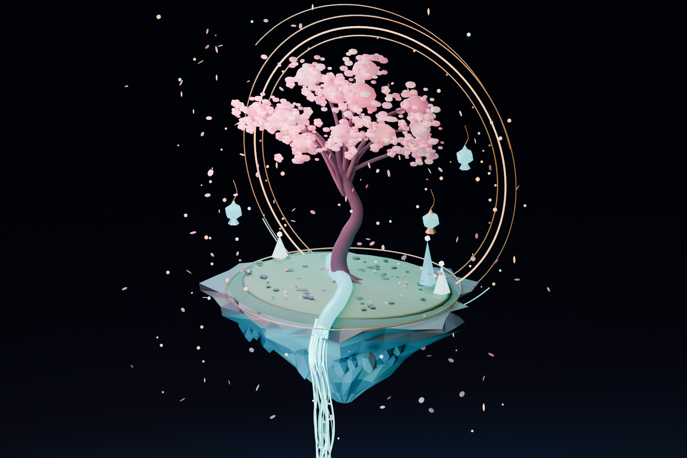

# Astral Garden — Floating Cherry Blossom Island

**Original open 3D scene | Blender 5.2.3 LTS | Motion Lab / tubban1**

A floating low-poly island with a luminous cherry blossom tree, golden celestial rings, turquoise waterfall, gem pendants and drifting petals. Fully modeled with Blender; **not an AI-generated 2D substitute**.

## Downloads

The easiest option is **`astral-garden-model-v1.zip`**, located in the same GitHub directory. Unzip it and choose:

| File | Purpose |
| --- | --- |
| `astral-garden.blend` | **Editable Blender project** with meshes, materials, lights, cameras and render settings (recommended). |
| `astral-garden.glb` | Standard glTF 2.0 binary model for browsers and other 3D applications. |
| `astral-garden-final.png` | Original 1920×1280 rendered preview. |
| `astral-garden.py` | Original procedural Blender scene generator. |
| `LICENSE-ASSETS.txt` | Creative Commons Attribution 4.0 International license for the 3D art. |
| `LICENSE-CODE.txt` | MIT license for the Python script. |

### Opening in Blender

1. Install **Blender 5.2.3 LTS** or later.
2. Download and extract `astral-garden-model-v1.zip`.
3. Open `astral-garden.blend` via **File → Open**.
4. Switch to camera view (numpad 0). Edit the tree, petals, rocks, rings, light fixtures or materials directly.
5. Render the saved camera view using **Render → Render Image** (F12). Scene was tested with Cycles CPU.

### Other apps

Import `astral-garden.glb` in apps supporting glTF 2.0 (e.g., Blender, Babylon.js, Three.js-based viewers). Blender-specific Cycles effects, the 3D scene lights, camera and shader appearance may not translate identically.

### Procedural reproduction

The `astral-garden.py` script generates the scene from scratch with `bpy`, using only built-in Blender geometry and materials; there are **no purchased meshes, downloaded textures or external assets**. If executing it on another computer, change the `ROOT` path at the top of the script to an existing output folder before running it. Running the script will save its own `.blend` and render into that folder; work on a separate copy.

## Open licenses

- **Artwork** (the `.blend`, `.glb`, PNG preview and original scene design): **CC BY 4.0**, including commercial use and modifications, with proper attribution.
- **Python generator**: **MIT License**.
- Suggested attribution: **“Astral Garden — Motion Lab / tubban1 (CC BY 4.0)”**.
- This release was created from original Blender procedural geometry; it contains no third-party model pack.

This is an art scene and model asset; it does not require a game engine or paid software add-ons.

---

## 中文说明

**《星环花园》**是一款可编辑的 Blender 3D 开源场景：漂浮岩岛、樱花树、金色星环、冰蓝瀑布、水晶吊灯及飘散的花瓣。

**下载方法：**在 GitHub 搜索用户 **tubban1**，进入 **motion-lab** 仓库，依次打开 **open-source → astral-garden**，下载 **astral-garden-model-v1.zip**。解压后：

- 使用 **Blender 5.2.3 LTS** 打开 `astral-garden.blend`，可修改模型、材质、灯光和摄像机；
- 其他支持 glTF 2.0 的软件可导入 `astral-garden.glb`；
- `astral-garden.py` 是从零创建场景的 Python 脚本；运行前先修改脚本里的 `ROOT` 输出目录；
- `astral-garden-final.png` 是完整渲染效果图。

**授权：**模型、GLB 与图片采用 **CC BY 4.0**，允许分享、修改和商业使用，但须署名；Python 生成脚本采用 **MIT**。署名建议：**Astral Garden — Motion Lab / tubban1**。
